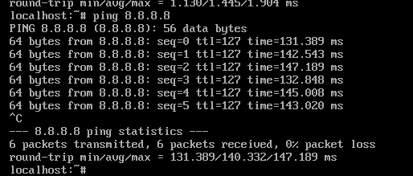
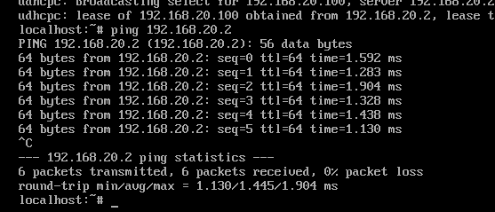
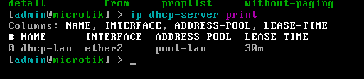
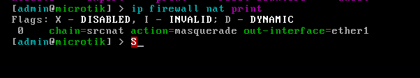
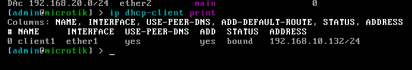
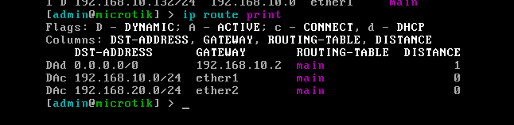

# Lab réseau virtuel : routeur MikroTik et client Alpine Linux

Mise en place, dans VMware Workstation, d'un réseau d'entreprise simulé. Un routeur MikroTik (RouterOS) assure la passerelle, le DHCP et le NAT d'un poste client Alpine Linux.

**Portfolio en ligne :** [yves-guidebe.github.io/lab-mikrotik-alpine](https://yves-guidebe.github.io/lab-mikrotik-alpine/)
**Aide-mémoire des commandes :** [commandes-lab-mikrotik-alpine.pdf](commandes-lab-mikrotik-alpine.pdf)

## Architecture

```
Internet - PC hôte - VMnet8 (NAT) - [ether1] MikroTik [ether2] - VMnet1 (privé) - Alpine
                     192.168.10.0/24                              192.168.20.0/24
```

| Élément | Valeur |
|---|---|
| WAN (ether1) | Client DHCP, 192.168.10.132/24, passerelle 192.168.10.2 (NAT VMware) |
| LAN (ether2) | 192.168.20.2/24 |
| Pool DHCP | 192.168.20.10 à 192.168.20.100 |
| Client Alpine | 192.168.20.100 (bail DHCP) |
| DHCP VMware sur VMnet1 | Désactivé, seul le MikroTik distribue les adresses |

## Configuration du routeur

```
/ip address add address=192.168.20.2/24 interface=ether2
/ip pool add name=pool-lan ranges=192.168.20.10-192.168.20.100
/ip dhcp-server network add address=192.168.20.0/24 gateway=192.168.20.2 dns-server=192.168.20.2,8.8.8.8
/ip dhcp-server add name=dhcp-lan interface=ether2 address-pool=pool-lan disabled=no
/ip dhcp-client add interface=ether1 disabled=no
/ip firewall nat add chain=srcnat out-interface=ether1 action=masquerade
/ip dns set allow-remote-requests=yes
```

## Configuration du client Alpine

```
ip link set eth0 up
udhcpc -i eth0
ping -c 3 8.8.8.8
```

## Résultats

| Test | Résultat |
|---|---|
| Client WAN du routeur | bound, 192.168.10.132/24 |
| Route par défaut | 0.0.0.0/0 via 192.168.10.2 |
| Serveur DHCP | actif sur ether2, pool-lan |
| NAT masquerade | actif sur ether1 |
| Alpine obtient une IP en DHCP | 192.168.20.100 depuis 192.168.20.2 |
| Ping Alpine vers le routeur | 6/6, 0 % de perte |
| Ping Alpine vers 8.8.8.8 | 6/6, 0 % de perte |

### Preuves


*Accès Internet depuis le client, à travers le routeur.*


*Le client obtient son bail du routeur puis le joint sans perte.*


*Serveur DHCP actif sur ether2 avec le pool pool-lan.*


*Règle de masquerade sur l'interface WAN.*


*Interface WAN en statut bound.*


*Route par défaut via la passerelle NAT, réseaux WAN et LAN connectés.*

## Incidents diagnostiqués

| Symptôme | Cause | Correction |
|---|---|---|
| Bail DHCP obtenu mais routeur injoignable | La carte VMnet1 de Windows utilisait déjà 192.168.20.1, l'adresse du routeur | Routeur passé en 192.168.20.2, passerelle et DNS du DHCP mis à jour |
| Routage incohérent | Le NAT VMware (VMnet8) et le LAN prévu étaient tous deux en 192.168.10.0/24 | LAN déplacé en 192.168.20.0/24, DHCP VMware désactivé sur VMnet1 |
| Le DHCP ne distribue rien | Serveur lié au pool static-only | `/ip dhcp-server set 0 address-pool=pool-lan` |
| Erreur « bad parameter name » | Commande saisie dans le mauvais sous-menu (`network`) | Séparer `network add` et `dhcp-server add` |
| « Network is down » sur Alpine | Interface eth0 à l'état DOWN | `ip link set eth0 up` |
| Pas d'Internet depuis le routeur | Coupure pendant le renouvellement du bail WAN | Diagnostic par étapes : bail, routes, passerelle NAT, service NAT de l'hôte |

## Méthode de diagnostic

Tester du plus proche au plus lointain : interface (`ip addr show eth0`), routeur (`ping 192.168.20.2`), Internet par IP (`ping 8.8.8.8`), puis DNS (`ping google.com`).

## Compétences

Plan d'adressage IP, routage et NAT, serveur et client DHCP, RouterOS en ligne de commande, réseaux virtuels VMware, Linux Alpine, diagnostic réseau, documentation technique.

## Contenu du dépôt

| Fichier | Rôle |
|---|---|
| `index.html` | Portfolio (page GitHub Pages) |
| `commandes-lab-mikrotik-alpine.pdf` | Aide-mémoire des commandes |
| `captures/` | Captures d'écran de validation |

## Auteur

Yves Guidebe - [GitHub](https://github.com/yves-guidebe)
